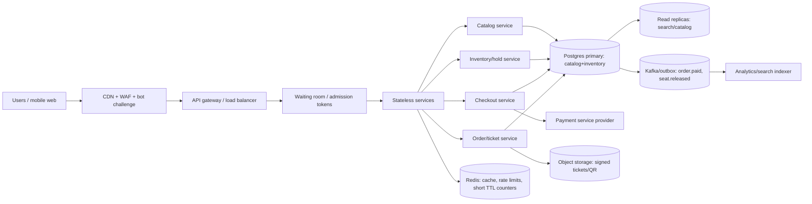

TicketHub — Event Ticketing System Design

Context and goals
TicketHub sells tickets for concerts and events. The dangerous moment is a “big sale”: 200,000 people try to buy the same 20,000 seats in the first 10 minutes. The design must stay fast, correct, and fair while never selling one seat twice.

Given facts used for estimates:
- 2,000,000 registered users.
- Normal day: 50,000 visitors × 10 pages = 500,000 page views/day.
- Normal day: 5,000 tickets sold.
- Big sale: 200,000 buyers arrive for 20,000 seats within 10 minutes.

---

1. Requirements

Functional requirements
1. Users can register/login and manage a profile.
2. Users can browse/search events by artist, city, venue, date, and price range.
3. Users can view an event’s seat map with live-enough availability: section, row, seat, price class, accessibility seats, and status (`available`, `held`, `sold`, `blocked`).
4. A user can hold one or more seats for a short TTL, e.g. 10 minutes, before paying. Holds are atomic per event and support all-or-nothing for a basket.
5. A user can pay for an active hold using a tokenized payment method through a PCI-DSS payment service provider; the system must be idempotent under retries/timeouts.
6. After successful payment, the system issues ticket(s), marks seats sold, and lets the user view/download tickets.
7. Holds expire automatically and release seats back to inventory.
8. Admins can create events, block seats, set prices, and view sales/reports.
9. The system records an audit trail for holds, releases, payments, refunds, and ticket issuance.
10. Out of scope for v1: complex resale marketplace, dynamic airline-style pricing, venue access-control hardware integration.

Non-functional requirements

Area	Requirement	
Correctness	Zero oversell: each `(event_id, seat_id)` can have at most one sold ticket. Holds must expire; payments must not be charged without inventory control.	
Speed	p95: event list/search < 300 ms; seat map read < 500 ms; hold creation < 800 ms; payment confirmation < 2 s, excluding PSP latency.	
Fairness	During a big sale, admitted buyers are processed FIFO from a waiting room. One account cannot monopolize seats; per-user/per-IP/per-device rate limits. Bots are challenged.	
Availability	99.9% monthly. During a flash sale, degrade gracefully: cached browsing stays up; purchase path is queued rather than crashing the DB.	
Scalability	Handle normal traffic easily; absorb a 10-minute spike roughly 1,000× normal purchase rate by admission control, caching, partitioning, and async processing.	
Consistency	Inventory is strongly consistent in Postgres. Catalog/analytics may be eventually consistent.	
Security	OAuth2/OIDC login, TLS everywhere, RBAC for admin, PSP tokenization so card data never touches TicketHub servers, signed tickets/QR with rotation, rate limiting, bot detection.	
Auditability	Every state change to a seat/hold/order is traceable to a user/request/payment idempotency key.	

---

2. Traffic estimates: normal vs big sale

Normal traffic
Assume activity is concentrated in 12 active hours/day.

- Page views: `500,000 / (12 × 3600) ≈ 11.6` page views/sec average.
- Evening peak might be 5–10× daily average: about 60–120 page views/sec.
- Ticket purchases: `5,000 / 86,400 ≈ 0.06`/sec average; evening peak maybe 5–20 purchases/sec.
- API reads dominate; only a small fraction of reads become holds and purchases.

Big-sale peak
For one event:
- 200,000 buyers / 600 sec = 333 buyer arrivals/sec average for 10 minutes.
- Inventory-limited sales: 20,000 seats / 600 sec = 33 seats sold/sec average if perfectly spread.
- Real flash sales are front-loaded. Design target: support 5,000 rps cached browsing, 1,000–3,000 rps purchase attempts at admission control, and 200–500 seat reservations/sec in short bursts while protecting the inventory database.

Comparison: the big sale is roughly 20–50× normal page-view peak for a few minutes and up to 1,000× the normal purchase rate for 10 minutes, but total purchased tickets are only `20,000 / 5,000 = 4×` a normal day because inventory is exhausted. The spike is arrival-rate and concurrency, not total successful purchases.

---

3. API design

Base URL: `https://api.tickethub.example/v1`
Auth: `Authorization: Bearer <OIDC access token>` for user actions; admin scope for event creation. All mutating endpoints require `Idempotency-Key`.

Endpoints
1. `GET /events?city=&date_from=&date_to=&q=&cursor=`

   List/search events. Cached heavily; returns cursor pagination.

2. `GET /events/{eventId}/seatmap`

   Returns sections, price classes, seat statuses, `map_version`, and `server_time`. Served from cache/CDN with short TTL; clients must submit `map_version` when holding so stale selections can be rejected.

3. `POST /events/{eventId}/holds` — body: `{ "seat_ids": ["A-12-04"], "idempotency_key": "...", "map_version": 9182 }`

   Atomically holds all requested seats or returns conflict/all-or-nothing failure. Response: `{ hold_id, expires_at, seats[], total_price }`.

4. `DELETE /holds/{holdId}`

   Explicitly releases a hold before expiry if unpaid.

5. `POST /orders` — body: `{ "hold_id": "...", "payment_token": "psp_tok_...", "idempotency_key": "...", "buyer": {...} }`

   Converts an active hold into a paid order. Idempotent: safe to retry after network failure/timeout.

6. `GET /orders/{orderId}`

   Buyer or admin views order status: `held/paid/failed/refunded`, tickets, payment status, refund state.

7. `GET /me/tickets?upcoming=true`

   List current user’s tickets with signed QR payload and transfer/cancel policy state.

Errors: `409 SEAT_UNAVAILABLE`, `410 HOLD_EXPIRED`, `422 STALE_MAP_VERSION`, `429 RATE_LIMITED`, `402 PAYMENT_FAILED`, `402 PAYMENT_PENDING`, `403 WAITING_ROOM_REQUIRED`.

---

4. Data model

Tables: `users`, `events`, `seats`, `holds`, `orders`, `order_items`, `payments`. Core invariant: at most one `order_items` row per `(event_id, seat_id)`.

```sql
users(id PK, email UNIQUE, password_hash, display_name, status, created_at)

events(id PK, title, venue_id, artist, city, starts_at, sale_starts_at,
       status, created_by FK users.id, created_at)

seats(id PK, event_id FK events.id NOT NULL, section, row_label, seat_number,
      price_class, price_cents, accessibility_flag DEFAULT false,
      status TEXT NOT NULL DEFAULT 'available' CHECK (status IN ('available','held','sold','blocked')),
      active_hold_id BIGINT NULL, version BIGINT NOT NULL DEFAULT 0, updated_at TIMESTAMPTZ,
      UNIQUE(event_id, section, row_label, seat_number))

holds(id PK, event_id FK NOT NULL, user_id FK NOT NULL, idempotency_key TEXT NOT NULL,
      status TEXT NOT NULL CHECK (status IN ('active','consumed','released','expired')),
      expires_at TIMESTAMPTZ NOT NULL, created_at TIMESTAMPTZ NOT NULL,
      UNIQUE(event_id, idempotency_key))
-- One active hold per seat:
CREATE UNIQUE INDEX holds_one_active_seat ON holds(event_id, seat_id) WHERE status = 'active';
-- holds.seat_id added for multi-seat all-or-nothing; for strict basket atomicity store hold_items below.

hold_items(hold_id FK holds.id, seat_id FK seats.id, price_cents_at_hold, PRIMARY KEY(hold_id, seat_id))
CREATE UNIQUE INDEX hold_items_one_active_seat ON hold_items(seat_id) WHERE hold_id IN (SELECT id FROM holds WHERE status='active'); -- enforced in app/DB migration; final guard is seats/tickets uniqueness.

orders(id PK, event_id FK NOT NULL, user_id FK NOT NULL, hold_id FK holds.id UNIQUE,
       status TEXT CHECK (status IN ('pending_payment','paid','failed','refunded','cancelled')),
       currency CHAR(3), total_cents, idempotency_key TEXT NOT NULL,
       created_at, paid_at,
       UNIQUE(event_id, idempotency_key))

order_items(order_id FK orders.id, event_id FK events.id NOT NULL, seat_id FK seats.id NOT NULL,
            ticket_code TEXT UNIQUE, status TEXT CHECK (status IN ('valid','cancelled','refunded','transferred')),
            PRIMARY KEY(order_id, seat_id))
-- Final no-double-booking constraint:
CREATE UNIQUE INDEX tickets_one_sold_seat ON order_items(event_id, seat_id) WHERE status <> 'refunded';

payments(id PK, order_id FK orders.id, psp_payment_id TEXT UNIQUE, psp_token TEXT,
         amount_cents, currency CHAR(3), status TEXT CHECK (status IN ('requires_action','succeeded','failed','refunded')),
         idempotency_key TEXT NOT NULL, created_at, updated_at)
```

Relationship summary: `users 1—n holds`, `users 1—n orders`, `events 1—n seats`, `events 1—n holds/orders`, `holds 1—n hold_items`, `orders 1—n order_items`, `orders 1—n payments`. `seats.active_hold_id` is a convenience pointer only; the DB constraints and transactional updates are authoritative.

---

5. How double-booking is prevented

The seat inventory authority is Postgres, not Redis or the client. Redis only caches counts/rate limits; cache misses or staleness can never create a sold ticket.

For holding seats, run in one transaction:

```sql
BEGIN;
-- Lock the exact rows for the requested seats in this event.
SELECT id FROM seats
WHERE event_id = :event_id AND id = ANY(:seat_ids)
FOR UPDATE;

-- All-or-nothing: every seat must be available or held by the same request and expired.
UPDATE seats
SET status='held', active_hold_id=:hold_id, expires_at=now()+interval '10 minutes',
    version=version+1, updated_at=now()
WHERE event_id=:event_id
  AND id = ANY(:seat_ids)
  AND (status='available' OR (status='held' AND expires_at <= now()))
RETURNING id;

-- If rowcount != number requested: ROLLBACK and return 409.
INSERT INTO holds(...), hold_items(...);
COMMIT;
```

For checkout/payment:

```sql
BEGIN;
-- Only the hold owner can convert; hold must still be active.
SELECT ... FROM holds WHERE id=:hold_id AND user_id=:uid FOR UPDATE;
IF status != 'active' OR expires_at <= now() THEN fail 410; END IF;

UPDATE seats
SET status='sold', version=version+1, updated_at=now()
WHERE id=:seat_id AND event_id=:event_id AND status='held'
  AND active_hold_id=:hold_id AND expires_at > now();
-- Must affect exactly one row per seat; otherwise rollback.

UPDATE holds SET status='consumed' WHERE id=:hold_id;
INSERT INTO orders(... status='pending_payment', ...);
INSERT INTO order_items(event_id, seat_id, ticket_code, status='valid') VALUES ...;
COMMIT;
```

The `tickets_one_sold_seat` unique index is the final safety net: even if application code has a bug, Postgres rejects a second non-refunded `order_items` row for the same event/seat. Retries are safe because `orders(event_id, idempotency_key)`, `holds(event_id, idempotency_key)`, and `payments.psp_payment_id` are unique. If the PSP call times out, do not release the hold immediately; query the PSP by idempotency key/payment id first, then mark `paid`, `failed`, or keep a short `pending_payment` grace state before release.

---

6. Architecture and how it survives the big sale



Component explanation:
- CDN/WAF/bot challenge: serves static assets and cached event pages; filters bots and absorbs simple floods.
- Waiting room/admission tokens: during `sale_starts_at`, users get a signed queue token. Admission rate is throttled to what checkout can safely do. This converts a 200k-user stampede into controlled concurrency. Browsing remains available; only hold/order creation requires an admission token.
- Catalog service: read-mostly, uses Postgres read replicas and cache. Event metadata can be eventually consistent.
- Inventory/hold service: the correctness-critical path. Stateless horizontally, but all writes go to the Postgres primary for a given event; shard by `event_id` if needed. It owns atomic seat state transitions.
- Checkout service: calls PSP with idempotency; never trusts webhook alone. On PSP timeout, reconciles by idempotency key before releasing inventory.
- Postgres primary: single writer for inventory constraints and unique indexes; partitioned by `event_id` for hot events; `FOR UPDATE` only touches requested seats to reduce lock scope.
- Redis: caches seat map counts and rate-limit buckets only; never authoritative for sold inventory.
- Kafka/outbox: emits `order.paid`, `hold.expired`, `seat.released`, `ticket.issued` for analytics, email, and search without slowing checkout.

Why it survives: most big-sale requests are reads and are cached/CDN-served. Only admitted users reach the hold path. The DB only sees a bounded number of concurrent seat-row locks, and each transaction locks a tiny number of rows (`seat_ids` in the request). Idempotency makes client retries harmless. If capacity is exceeded, the queue grows rather than dropping correctness.

---

7. Trade-offs

1. Strong inventory consistency vs raw write throughput. Unique indexes, `FOR UPDATE`, and all-or-nothing multi-seat transactions reduce peak write throughput compared with a Redis-first design. I accept this because overselling is worse than slower sales. Mitigations: admission queue, row-level locks only for requested seats, partition hot events, keep cached reads off the primary.

2. Waiting room fairness vs conversion/urgency. FIFO is fair and easy to explain, but admitted users near the front get a big advantage and late users may see “sold out” after waiting. Alternative: lottery or randomized admission waves; chosen FIFO because the prompt emphasizes fairness and auditability.

3. Cached seat map freshness vs database load. A 1–5 second cached seat map keeps the site responsive under 5k rps, but users can see stale `available` seats and get `409 SEAT_UNAVAILABLE` at hold time. I prefer fast stale reads plus guaranteed transactional rejection over exact real-time maps, which would hammer the primary.

4. All-or-nothing multi-seat holds vs higher success rate. Requiring an entire basket to be free is better UX and safer for groups, but one contested seat can fail the whole hold. Mitigation: hold request size limit, clear conflict response, suggested nearby seats, and expired-hold release.

---